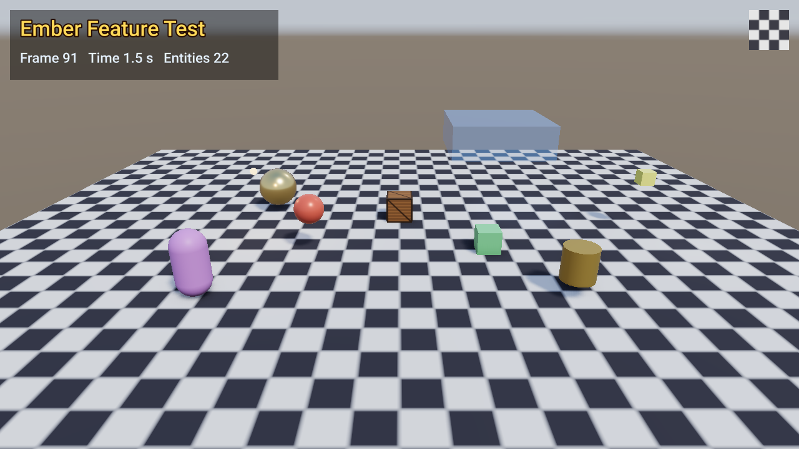
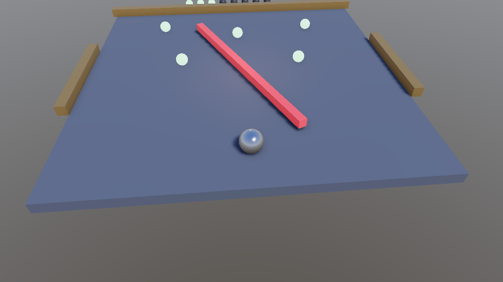

# Ember

Ember is a simple, production-grade 3D game engine written in C++20. It runs on Windows, macOS (MoltenVK),
Linux and Raspberry Pi OS (Pi 5), renders with Vulkan through NVRHI, and is built so that **an AI agent can make a
complete game with it** through the editor's JSON control interface: no clicking required.



*The feature test scene, built entirely through the AI interface and rendered headless on a Raspberry Pi 5.*

## Features

- **Rendering**: physically based (metallic-roughness) forward renderer. Image-based lighting from HDRIs (e.g.
  [Poly Haven](https://polyhaven.com/hdris)) or a procedural sky, cascaded soft shadows (PCSS), SSAO, HDR pipeline
  with ACES tonemapping, directional/point/spot lights, emissive/alpha-mask/transparent materials, glTF 2.0
  models and textures, frustum culling.
- **Scene**: entity-component system (EnTT) with hierarchy, prefabs and readable YAML scene files.
- **Physics**: Jolt Physics: dynamic/kinematic/static bodies, box/sphere/capsule colliders, triggers, raycasts,
  forces, collision callbacks.
- **Scripting**: sandboxed Lua 5.4 with a complete gameplay API (entities, components, input, physics, audio,
  prefabs, modules). See [docs/ScriptingAPI.md](docs/ScriptingAPI.md).
- **Audio**: miniaudio, positional sources and one-shots.
- **Editor**: docking ImGui editor with viewport gizmos, picking, hierarchy, inspector, asset browser, console,
  play/pause/step, undo/redo, game export.
- **AI control**: 50+ JSON commands over a localhost socket or batch files, a headless mode with offscreen
  capture, deterministic frame stepping and input injection. See [docs/AIControl.md](docs/AIControl.md).
- **Runtime**: standalone player; export produces a folder with the executable, project file and assets.

## Building

Requirements: CMake 3.25+, a C++20 compiler (GCC 11+, Clang 14+, MSVC 2022), the Vulkan SDK / headers and
`glslangValidator`, Python 3 (tools only). All other dependencies are fetched and pinned by CMake.

**Linux / Raspberry Pi OS**

```bash
sudo apt install cmake ninja-build libvulkan-dev glslang-tools spirv-tools libwayland-dev libxkbcommon-dev xorg-dev \
                 vulkan-validationlayers   # optional, recommended for development
cmake -S . -B build -G Ninja -DCMAKE_BUILD_TYPE=Release
cmake --build build -j4
```

**Windows**: install the [Vulkan SDK](https://vulkan.lunarg.com/), then
`cmake -S . -B build && cmake --build build --config Release`.

**macOS**: install the Vulkan SDK (includes MoltenVK and glslangValidator), then build as on Linux.

Build types: `Debug`, `Release`, `RelWithDebInfo`, `Dist` (shipping: no asserts, editor tooling compiled out).
The first configure downloads dependencies and takes a few minutes.

## Using the editor

```bash
./build/bin/EmberEditor --project TestProject          # open the feature test project
./build/bin/EmberEditor                                # then File > New Project...
```

Viewport: right mouse + WASD/QE to fly, Alt + left mouse or middle mouse to orbit, Shift + middle mouse to pan,
scroll to zoom, Q/W/E/R for select/move/rotate/scale gizmos, F to focus, Ctrl+P to play.
Ctrl+S save, Ctrl+Z/Y undo/redo, Ctrl+D duplicate, Delete to delete. Drop files on the window to import them;
drag assets from the asset browser into the viewport or onto inspector fields.

## Letting an AI build a game

```bash
./build/bin/EmberEditor --headless --ai-server         # no display needed
```

```python
import sys; sys.path.insert(0, "Tools")
from ember_ai import EmberEditor

with EmberEditor.launch() as editor:
    editor.call("new_project", path="/tmp/Bounce", name="Bounce")
    editor.call("create_entity", name="Ball", components={
        "Transform": {"Translation": [0, 4, 0]},
        "MeshRenderer": {"Mesh": "builtin://Sphere", "MaterialOverride": {"BaseColor": [1, 0.3, 0.1]}},
        "RigidBody": {"Type": "Dynamic", "Restitution": 0.7}, "SphereCollider": {}})
    editor.call("create_entity", name="Floor", components={
        "Transform": {"Scale": [10, 0.2, 10]}, "MeshRenderer": {"Mesh": "builtin://Cube"}, "BoxCollider": {}})
    editor.call("run_frames", frames=60)
    print(editor.call("capture", path="/tmp/bounce.png"))
    editor.call("stop")
    editor.call("save_scene")
    editor.call("export_game", output="/tmp/Bounce_Build")
```

Agents using Claude Code get step-by-step guidance from the skills in `.claude/skills/` (`ember-build-game`,
`ember-engine-dev`).

**Example**: [`Examples/OrbCollector/build_game.py`](Examples/OrbCollector/build_game.py) builds a complete small
game (rolling-ball orb collector with physics, triggers, prefabs, scoring, sounds and a follow camera) purely
through the AI interface, play-tests it with simulated keyboard input and exports it. Open the result with
`./build/bin/EmberEditor --project Examples/OrbCollector/Project`.



## Running a game

```bash
/tmp/Bounce_Build/Bounce                               # exported game (finds its project next to it)
./build/bin/EmberRuntime --project TestProject         # run a project without exporting
./build/bin/EmberRuntime --project TestProject --headless --frames 300 --screenshot shot.png
```

## Tests

```bash
./build/bin/EmberTests                                 # unit and GPU tests (real GPU)
EMBER_GPU=llvmpipe ./build/bin/EmberTests              # on the CPU rasterizer (CI without a GPU)
./build/bin/EmberEditor --project TestProject --run-tests --frames 400   # feature test scene
cd build && ctest --output-on-failure                  # all of the above
```

GPU tests run with Vulkan validation enabled and fail on any validation error. The feature test scene exercises
every component and the whole scripting API.

## Repository layout

| Path | Contents |
|---|---|
| `Ember/` | Engine library (`src/Ember/{Core,Renderer,Scene,Physics,Scripting,Audio,Project,ImGui,Math}`, `shaders/`) |
| `EmberEditor/` | Editor: `Core/` (editor state, command API, AI server, exporter), `App/` (ImGui UI) |
| `EmberRuntime/` | Standalone game player |
| `EmberTests/` | doctest suite |
| `TestProject/` | Feature test project |
| `Tools/` | AI client, test project builder, asset generator, docs generator |
| `docs/` | Scripting API, AI control interface |

Development guidelines: [AGENTS.md](AGENTS.md).

## License and third-party software

Ember uses GLFW, NVRHI, Vulkan-Headers, glm, spdlog, EnTT, yaml-cpp, Jolt Physics, Lua, sol2, miniaudio, cgltf,
stb, Dear ImGui, ImGuizmo, nlohmann/json and doctest; see each project for its license. Pinned versions are listed in
`cmake/EmberDependencies.cmake`.
